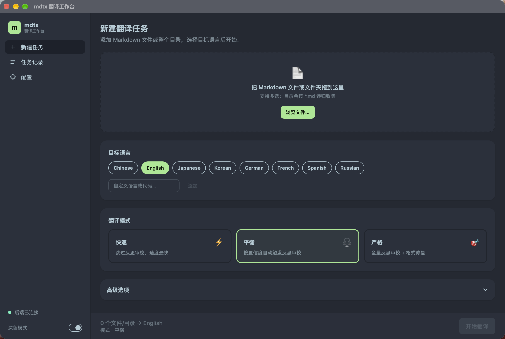
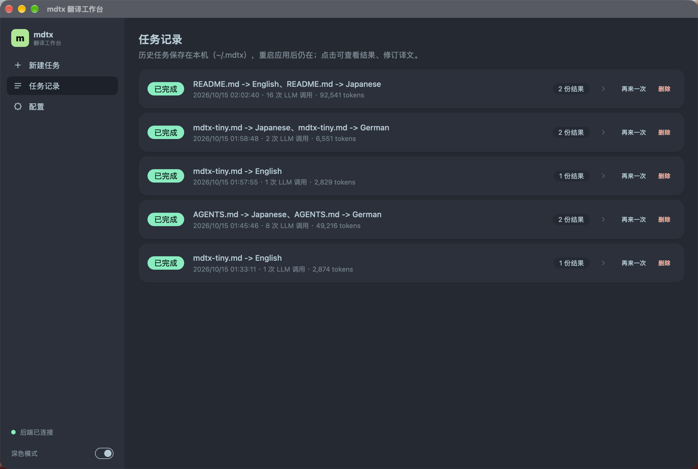
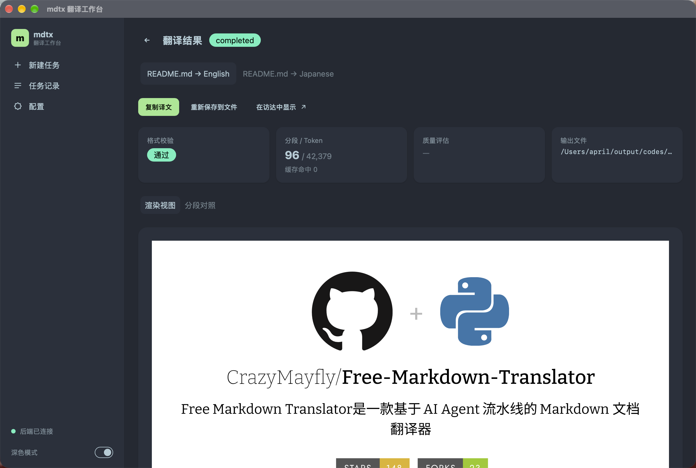
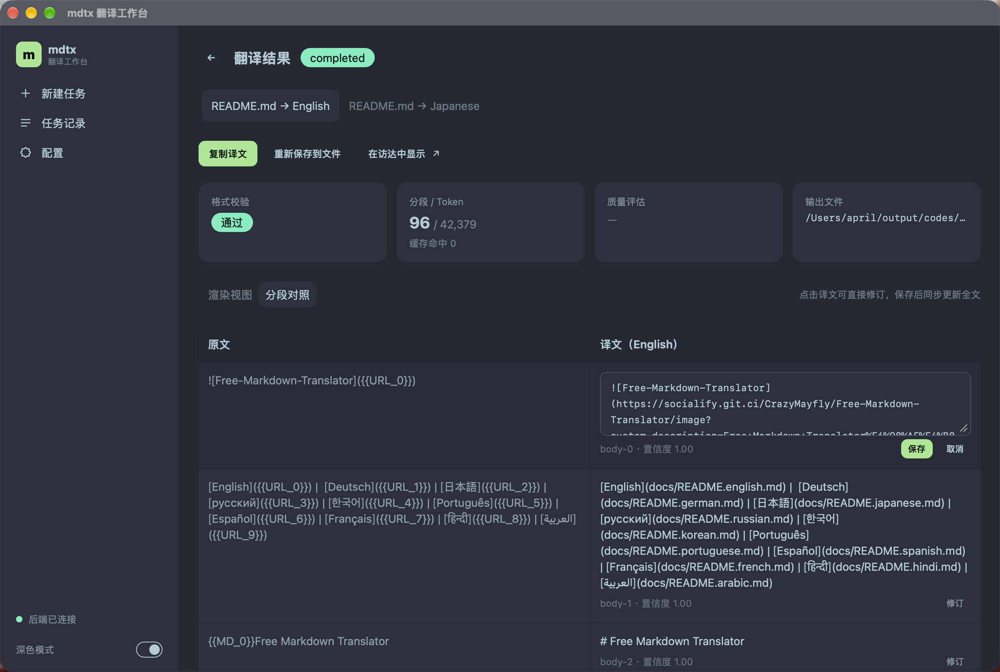
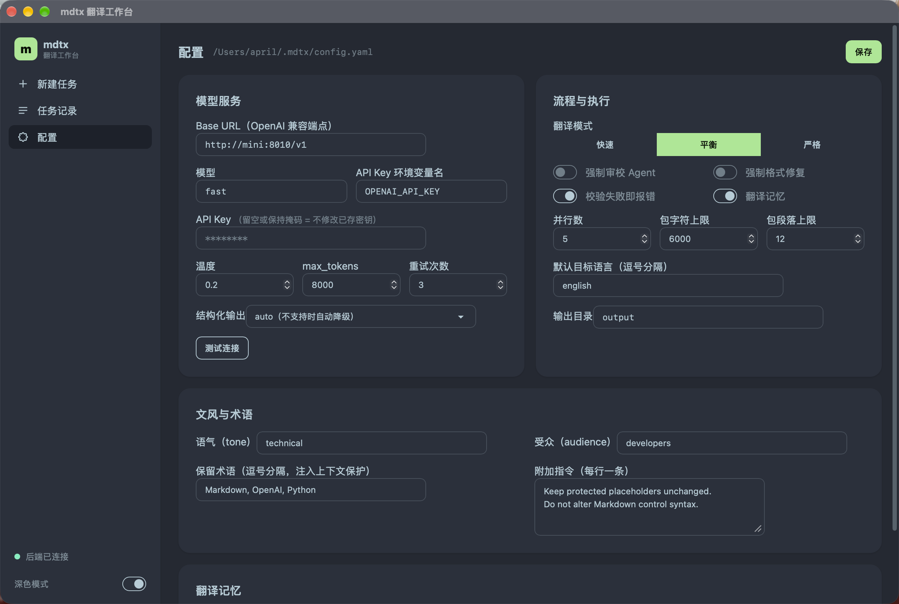

[English](docs/README.english.md) |  [Deutsch](docs/README.german.md) | [日本語](docs/README.japanese.md) | [русский](docs/README.russian.md) | [한국어](docs/README.korean.md) | [Português](docs/README.portuguese.md) | [Español](docs/README.spanish.md) | [Français](docs/README.french.md) | [हिन्दी](docs/README.hindi.md) | [العربية](docs/README.arabic.md)

# Free Markdown Translator

基于 AI Agent 流水线的 Markdown 文档翻译工具：支持 40+ 语言，保留原始文档结构，保持语义连贯。

## 特性

| 领域 | 能力 |
| --- | --- |
| 🈯️ 术语一致 | 译前抽取术语表、译后修正漂移译法；持久化术语库跨运行累积，人工条目优先于模型投票（`/api/glossary` 可管理） |
| 🔗 上下文连贯 | 分包对齐章节边界（表格不拆包）；每包携带文档大纲、术语表、前一包摘要；锚点调度为并行包注入真实译文；模型可主动请求更深的记忆检索；文内锚点链接自动跟随译后标题 |
| ✅ 质量保障 | 反思式审校（批评 → 修复 → 复核）；语义哨兵（占位符/数字守恒、长度比）零成本拦截丢内容；`quality` 模式文档级终审；`--eval` LLM-as-judge 打分；`--regression` 黄金样例回归 |
| 💰 成本效率 | 翻译记忆（相同段落零调用复用、相似段落模糊复用或作 few-shot）；`--resume` 断点续传；asyncio 并发 + 限流退避 |
| 🧱 结构稳定 | Structured Outputs 受限解码（端点不支持自动降级）；截断精确识别；代码/URL/表格/标题占位符保护；校验失败自动格式修复 |
| 🔌 灵活集成 | 任意 OpenAI 兼容端点（OpenRouter / DeepSeek / Ollama / vLLM…）；审校与评审可配独立模型；`--serve` MCP 模式；桌面应用 |

三档模式：`fast`（省 token 提速）、`balanced`（默认）、`quality`（全量审校 + 终审）。

## ⚡ Quick Start

```bash
pip install -e .
mdtx --init-config          # 生成 ~/.mdtx/config.yaml，填入 API Key
mdtx README.md --to english,japanese
```

Windows 可直接下载 `mdtx.exe`（见下方桌面应用），命令相同（`.\mdtx.exe --init-config`）。

### 常用命令

```bash
mdtx docs --to Chinese --match "*.md"      # 目录递归（正则匹配文件名）
mdtx docs --to Chinese --threads 10        # 提高并行度
mdtx docs --to Chinese --mode quality      # 质量模式（更慢更贵，效果更好）
mdtx docs --to Chinese --review true --guard true   # 强制审校 + 格式保护
mdtx README.md --to Chinese --model gpt-5-mini --tone technical
mdtx README.md --to Chinese --eval         # 翻译并做质量评估
mdtx docs --to Chinese --resume            # 从中断处续传
mdtx --verbose README.md --to Chinese      # 详细日志
```

## 🖥️ 桌面应用（Tauri 2 + Vue3 + Python sidecar）

仅监听 `127.0.0.1`，不依赖云服务。到 [Releases](https://github.com/CrazyMayfly/Free-Markdown-Translator/releases) 下载安装包（GitHub Actions 自动构建）：

| 平台 | 产物 |
|------|------|
| macOS (Apple Silicon) | `mdtx_3.2.0_aarch64.dmg`（未签名，首次打开需右键 → 打开） |
| Windows x64 | `mdtx_3.2.0_x64-setup.exe` |
| Ubuntu/Debian | `mdtx_3.2.0_amd64.deb`（另有通用 `AppImage`） |

首次启动后在「配置」页填入 base_url / API Key / 模型，用「测试连接」验证后即可开始翻译。

| 新建任务 | 任务记录 | 翻译结果 | 分段对照 | 配置 |
|---|---|---|---|---|
|  |  |  |  |  |

- **新建任务**：拖拽 / 文件浏览器多选文件或目录（按 `*.md` 递归）、语言多选、三档模式、断点续传
- **实时进度**：任务 × 翻译对双层进度、bundle 级进度条、token 实时统计（含缓存命中）、阶段时间轴与耗时、SSE 事件流
- **任务记录**：本机持久化（`~/.mdtx/history.sqlite3`），支持「再来一次」与删除
- **结果页**：渲染 / 分段对照双视图，段落级修订自动同步全文，一键复制 / 保存 / 访达显示
- **写失败保护**：输出写失败时译文不丢，结果页可手动保存；后台完成弹系统通知
- **配置管理**：表单化编辑 `~/.mdtx/config.yaml`（Key 掩码不回显）、端点连通性测试、翻译记忆统计与清空、术语表管理

### 本地开发

```bash
mdtx --ui-port 8000                        # 终端 1：API
cd ui && npm install && npm run dev        # 终端 2：vite → http://localhost:5173

cd ui && npx tauri dev                     # Tauri 桌面窗口（自动带起 vite 与 API）

.venv/bin/python src/buildtool/build_api.py   # 打包：先构建 sidecar
cd ui && npx tauri build                      # 再构建 .app / .dmg
```

环境：Node ≥18、Rust stable、Python 依赖 `pip install -e ".[ui]"`。推送 `v*` 标签即触发三平台构建并发布 Release。

## 🤖 MCP 工具

```bash
pip install "mdtx[mcp]" && mdtx --serve
```

```json
{ "mcpServers": { "mdtx": { "command": "mdtx", "args": ["--serve"] } } }
```

- `translate_markdown(path, target_langs, mode?, tone?, model?, write?)`：翻译并返回译文、校验结果与 token 用量
- `evaluate_translation(path, target_lang)`：翻译并用 LLM-as-judge 打分（准确度/流畅度/术语/格式）

## 🔌 兼容的模型服务

| 服务 | base_url |
|------|----------|
| OpenAI | `https://api.openai.com/v1`（完整支持 Structured Outputs） |
| OpenRouter | `https://openrouter.ai/api/v1` |
| DeepSeek | `https://api.deepseek.com/v1` |
| Ollama（本地） | `http://localhost:11434/v1` |
| vLLM（本地） | `http://localhost:8000/v1` |

`provider.name` 仅作标识，实际端点由 `base_url` 决定；`structured_outputs: auto`（默认）在端点不支持受限解码时自动回退。

## ⚙️ 配置

查找顺序：`--config` → 仓库根 `config.yaml` → `src/config.yaml` → `~/.mdtx/config.yaml`。

```yaml
target_languages: [english, japanese]

execution:
  max_parallel_translations: 10      # bundle 级全局并发

provider:
  name: openai
  base_url: https://api.openai.com/v1
  api_key_env: OPENAI_API_KEY        # 推荐用环境变量；也可直填 api_key
  model: gpt-4o
  temperature: 0.2
  max_tokens: 8000

pipeline:
  mode: balanced                     # fast | balanced | quality
  fast_model: ""                     # 可选模型路由，留空用 provider.model
  quality_model: ""
  brief_model: ""
  enable_review: false               # 强制审校（balanced 默认只审可疑包）
  enable_format_guard: false
  fail_on_validation_error: true

segmentation:                        # 预算按估算 token 计（非字符）
  max_bundle_tokens: 4000            # 单包硬上限
  min_bundle_tokens: 1000            # 小章节合并阈值，0 = 不合并

input:
  file_pattern: "*.md"

style:
  tone: technical
  audience: developers
  preserve_terms: [OpenAI, Markdown, Python]   # 不译且受保护
  instructions:
    - Keep protected placeholders unchanged.
    - Do not alter Markdown control syntax.

output:
  directory: output
  file_suffix_template: "{stem}.{lang}.md"     # {stem} 文件名，{lang} 语言缩写
  write_report: false                          # 额外写出 *.report.json
```

## 🔄 执行流程

1. 解析为 AST → 提取可翻译片段（占位符与控制语法受保护）
2. 生成文档摘要、标题大纲、风格约束与术语上下文；`GlossaryAgent` 抽取术语表并与持久化术语库合并
3. `Orchestrator` 按结构打包（标题处对齐章节、表格不拆包），查询翻译记忆（精确复用 / 模糊复用 / few-shot）
4. 锚点-并行调度：每章首个包串行，其余并行并携带锚点真实译文
5. `TranslatorAgent` 逐包翻译（Structured Outputs）；模型可对存疑段落发 `context_requests` 触发更深检索后重译（`fast` 关闭）
6. 语义哨兵做占位符/数字守恒与长度比检查，异常即强制审校该包
7. `ReviewerAgent` 反思式审校（批评 → 修复 → 复核）；术语一致性 pass 修正译法漂移并回写术语库；`quality` 模式再加文档级终审
8. 渲染回 AST 输出 Markdown（锚点链接自动跟随译后标题）→ 结构校验 → 失败则 `FormatGuardAgent` 修复 → 写入翻译记忆与断点

## 🗂️ 项目结构

```text
src/
├─ agents/      Agent 与提示词：翻译、审校、评估、术语协调、格式保护
├─ api/         FastAPI：任务管理、SSE 进度、配置/记忆路由（UI 后端）
├─ cli/         命令行入口与参数处理
├─ core/        流水线、任务编排、核心数据结构
├─ infra/       配置加载与日志
├─ llm/         模型客户端（同步/异步）、Provider、Schema
├─ mcp_server/  MCP server
├─ memory/      文档上下文、翻译记忆、断点续传
├─ parser/      Markdown 解析、AST 映射、渲染、分段
└─ validators/  front matter 与结构校验
ui/             Tauri + Vue3 桌面工程（前端 ui/src，桌面壳 ui/src-tauri）
src/buildtool/  打包脚本（Windows exe / macOS sidecar）
```

## Star History

<a href="https://star-history.com/#CrazyMayfly/Free-Markdown-Translator&Date">
 <picture>
   <source media="(prefers-color-scheme: dark)" srcset="https://api.star-history.com/svg?repos=CrazyMayfly/Free-Markdown-Translator&type=Date&theme=dark" />
   <source media="(prefers-color-scheme: light)" srcset="https://api.star-history.com/svg?repos=CrazyMayfly/Free-Markdown-Translator&type=Date" />
   
 </picture>
</a>
