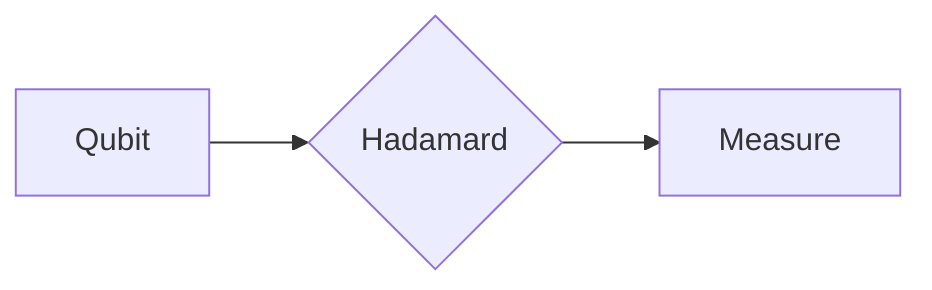

# Quantum Computing Primer

Inline math like $|\psi\rangle = \alpha|0\rangle + \beta|1\rangle$ must survive
translation untouched, and so must display math:

$$
E = \hbar\omega \quad \text{where } \hbar \approx 1.054 \times 10^{-34}
$$

## Circuit diagram

Diagrams stay in fenced blocks with their original language tag:

Only `title` and `description` are translated; `tags` and other front-matter
keys pass through verbatim.
